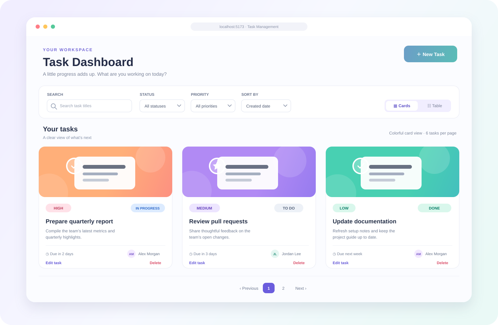

<div align="center">

# Task Management Spec Kit

### A colorful, responsive workspace for keeping work moving.

Built with **React** and **Java 21 + Spring Boot**, backed by **H2**.

[Features](#features) · [Get started](#get-started) · [API](#api) · [How it was built](#built-with-spec-kit)

</div>

## Dashboard preview



<div align="center"><sub>Illustrated UI preview of the current dashboard layout.</sub></div>

## Features

- Create, view, edit, assign, and delete tasks.
- Track **TODO**, **IN PROGRESS**, and **DONE** work with **LOW**, **MEDIUM**, and **HIGH** priorities.
- Search task titles and filter by status or priority.
- Switch between colorful task cards and a table view.
- Sort by due date, priority, or creation date.
- Server-side pagination, showing **6 tasks per page by default**.
- Responsive layouts for desktop and mobile.
- Five example tasks are added to H2 at startup when the task table is empty.
- Request validation, structured error responses, and interactive OpenAPI documentation.

## Tech stack

| Area | Technologies |
| --- | --- |
| Frontend | React, TypeScript, Vite, CSS |
| Backend | Java 21, Spring Boot, Spring Web, Spring Data JPA |
| Database | H2 |
| Testing | JUnit 5, Mockito, Spring Boot Test, Vitest |
| API docs | OpenAPI / Swagger UI |

## Get started

### Prerequisites

- Java 21
- Maven
- Node.js and npm

### Start the backend

```powershell
cd backend
mvn spring-boot:run
```

The API is available at `http://localhost:8080`. Interactive API documentation is
at [`http://localhost:8080/swagger-ui.html`](http://localhost:8080/swagger-ui.html).

### Start the frontend

In another terminal:

```powershell
cd frontend
npm ci
npm run dev
```

Open the local URL printed by Vite. The frontend expects the API at
`http://localhost:8080` by default; set `VITE_API_URL` to use another backend URL.

### Run tests and build

Backend tests and the configured JaCoCo coverage gate:

```powershell
cd backend
mvn clean verify
```

Frontend tests and production build:

```powershell
cd frontend
npm ci
npm test
npm run build
```

## API

| Method | Endpoint | Purpose |
| --- | --- | --- |
| `GET` | `/api/tasks` | Search, filter, sort, and page tasks |
| `POST` | `/api/tasks` | Create a task |
| `GET` | `/api/tasks/{id}` | View a task |
| `PUT` | `/api/tasks/{id}` | Update a task |
| `DELETE` | `/api/tasks/{id}` | Delete a task |
| `GET` | `/api/users` | List task assignees |

List requests accept `search`, `status`, `priority`, `sort`, `direction`, `page`,
and `size` query parameters. Page numbering starts at zero; the default page size
is six, and supported page sizes range from 1 to 100.

## Built with Spec Kit

This project was developed through a Spec-Driven Development workflow using
[GitHub Spec Kit](https://github.com/github/spec-kit):

1. **Constitution** — established project principles, including specification
   before implementation, test-first development, clear interfaces, and reliability.
2. **Specification** — described the user journeys, acceptance scenarios,
   functional requirements, edge cases, and measurable outcomes for the task system.
3. **Plan** — recorded the Java/Spring and React architecture, design decisions,
   data model, REST contract, and validation guide.
4. **Tasks** — broke the work into independently testable, user-story-based tasks.
5. **Implementation** — followed the task breakdown, adding the backend, dashboard,
   seed data, tests, and documentation; build and test feedback informed fixes.

The feature artifacts—including `spec.md`, `plan.md`, `research.md`,
`data-model.md`, `contracts/openapi.yaml`, `quickstart.md`, and `tasks.md`—were
maintained in the Spec Kit project workspace while the application was developed.

---

<div align="center"><sub>Designed to make the next task easy to see—and easy to start.</sub></div>
